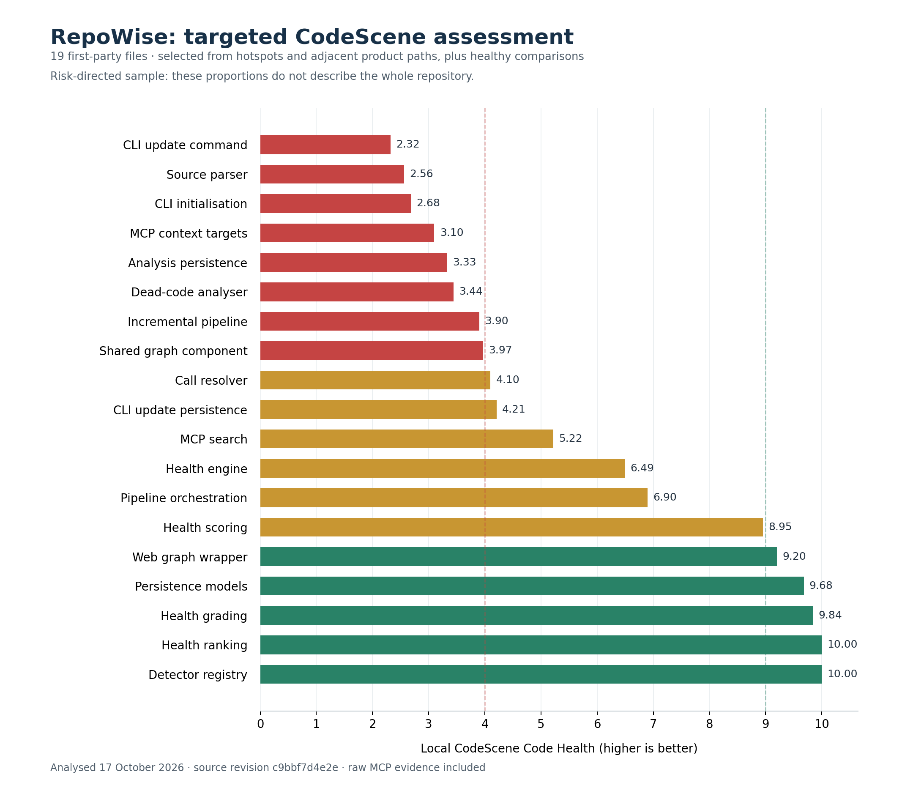

# RepoWise code health assessment

RepoWise’s “2.3× defects found vs CodeScene” headline overstates the published result: retrospective file ranking against per-file CodeScene CLI scores. Please remove that claim and describe the experiment accurately.

The codebase also carries significant technical debt in frequently changed product code. CodeScene reports overall Code Health of **8.60/10**, but **4.72/10 in hotspots**.

| Priority file | Cloud health /10 | Local MCP health /10 | Historical revisions |
|---|---:|---:|---:|
| CLI update command | 2.23 | 2.32 | 141 |
| Source parser | 2.56 | 2.56 | 105 |
| Analysis persistence | 3.27 | 3.33 | 115 |
| Dead-code analyser | 3.45 | 3.44 | 112 |

These are first-party files under `packages/*/src`, not installed dependencies. Cloud and local scores are separate measurements; the differences are not improvement trends.

Concrete examples:

- `run_update`: **2,073 physical lines, 21 parameters**.
- `init_command`: **1,233 physical lines, 40 parameters**.
- `_persist_full_update_async`: **cyclomatic complexity 98, 25 parameters**, spanning 705 physical lines.

That concentration of complexity makes changes harder to review and raises maintenance risk in code the team changes regularly. The update-command refactoring model estimates **5–26% less implementation time** if its health improves from 2.32 to 5.15. This is a modelled range, not measured RepoWise savings.

**Recommendation:** use CodeScene to baseline these hotspots, prevent further health regressions in PRs and refactor them incrementally. Please also remove the broader superiority wording unless there is evidence supporting it.

This review covers 19 selected files. Some score **10/10**; the project and hotspot averages have both improved slightly. Technical debt does not invalidate a benchmark. The objection is to the claim made about that benchmark.

Prepared 17 October 2026 against `c9bbf7d4e2ed3f352bc4da0d6a5fdce561179819`. All 19 reviewed files are unchanged at this PR’s base, `adaf956dd503237b1fe4377c697b363bdb9ed995`. Daniel Webb is CTO at NeoSee, a CodeScene partner.

[All 19 file scores](file-scores.csv) · [Full analysis, raw MCP evidence and reproduction scripts](evidence.zip) · [Checksums](SHA256SUMS)

